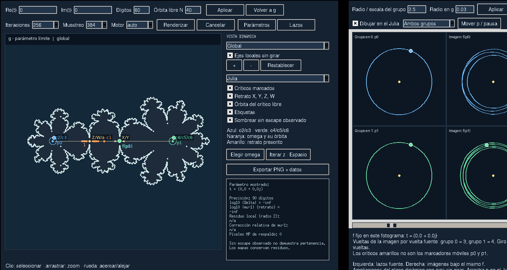
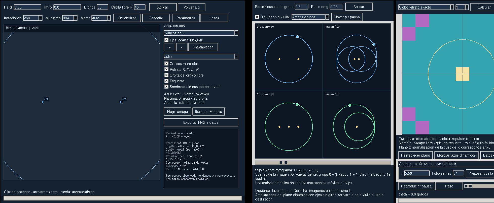
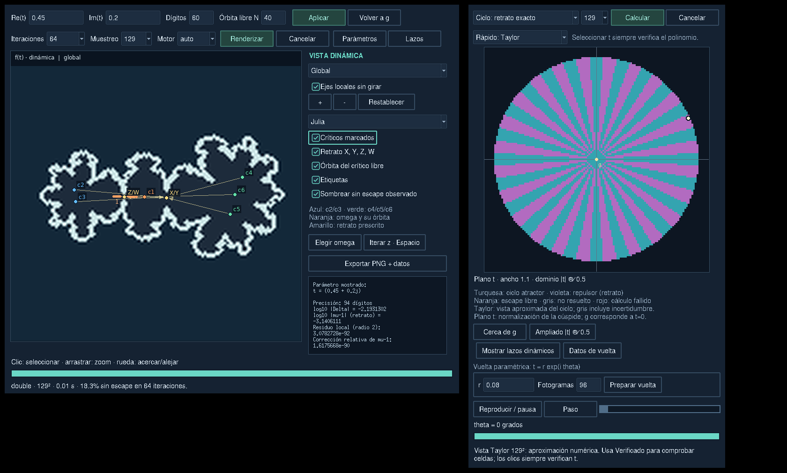

# Polynomial Cusps

Numerical exploration of the degree-seven parabolic counterexample whose
critically marked portrait closure has an irreducible cusp.

**Current stage: M03.2 — cached parameter-circle movies.** Two Tk windows show the normalization parameter t near g and the
selected polynomial's dynamics. A separate loop inspector magnifies marked
regular points p and their actual images f(p), f²(p) in the dynamical plane.

The two-plane interaction follows [draw_tricorn](https://github.com/zNe4/draw_tricorn).
This repository implements the family independently; no source code from
draw_tricorn has been copied.

## Run

Python 3.10 or newer is required. The only runtime dependency is mpmath.

```bash
git clone https://github.com/zNe4/polynomial-cusps.git
cd polynomial-cusps
python -m venv .venv
source .venv/bin/activate
python -m pip install -e .

# Boundary polynomial g.
python -m polynomial_cusps --orbit 20

# A nearby complex parameter.
python -m polynomial_cusps --real 0.1 --imag 0.03 --dps 60 --orbit 40

# Tiny separations, logarithmic sizes, and stable multiplier/return data.
python -m polynomial_cusps --real 1e-8 --dps 60 --orbit 0 --rescaled
```

### Open the graphical explorer

Install Tk from your operating system (`sudo pacman -S tk` on Arch Linux,
or `sudo apt install python3-tk` on Ubuntu/Debian), then install the GUI extras:

```bash
python -m pip install -e '.[gui]'
python -m polynomial_cusps --gui
# Or start at a selected parameter:
python -m polynomial_cusps --gui --real 0.08 --imag 0.06 --orbit 40
```

The installed `polynomial-cusps-gui` command opens the same application.
The dynamical and parameter windows open together.
Press **Ctrl+Q** in either window to quit the application. In the dynamical
loop window, **Ctrl+Q** closes only that window; **Lazos** opens it again.
A graphical display is required. The numerical console remains available
without NumPy, Pillow, or Tk.

- Click the parameter plane to choose t, or enter Re(t), Im(t), decimal
  accuracy, and free-orbit length in the dynamical window and press **Aplicar**.
- Use **Volver a g** to restore the boundary polynomial.
- Choose **Global**, either critical cluster, the critical values, or the cycle.
  Local charts require nonzero t. Switching parameters preserves the current
  viewport unless returning to g makes the local chart collapse.
- Leave **Ejes locales sin girar** enabled to see the critical points rotate
  when the argument of t changes. The local scale is then positive real.
- Click to select a dynamical point; use **Iterar z** or Space to apply f.
  Space retains its normal behavior in text inputs. **Elegir omega** selects
  the free critical point.
- Drag a rectangle or use the wheel / + / - buttons to zoom.
- Toggle critical markers, the prescribed orbit graph, free-orbit points,
  labels, and finite-time unresolved shading separately.
- **Exportar PNG + datos** saves the displayed numerical snapshot with
  metadata embedded in the PNG and in a sibling JSON file. Export uses the
  completed frame, even when another parameter is being calculated.

### Two independent motions

- **Parameter circle:** in **Parámetros**, enter a small radius r, press
  **Preparar vuelta**, then **Reproducir / pausa**, **Paso**, or move the
  angle slider. This changes the polynomial along `t = r exp(i theta)`,
  with g at t=0 and radii up to 0.5. The critical points follow the changing polynomial.
- **Dynamical loops:** press **Lazos**. The blue/green source circles enclose
  the critical groups near 0 and 1. Their marked points p0,p1 and images
  f(p0),f(p1), and f²(p0),f²(p1) are drawn on the Julia view. Use **Mover p / pausa**, the loop
  slider, or drag on a source circle to move the marker without changing f.
  Six auxiliary panels magnify these same dynamical curves and points: source,
  first image near X/Y, and second image near the cycle Z/W.
  Both animations can run together; changing f preserves the marker phase.
- At **g**, use **Radio en g** to set the absolute source radius. At nearby
  f, **Radio / escala del grupo** sets the radii relative to |x| and |s|.
  Default loops have image winding numbers 3 and 4, respectively. These
  numbers concern whole critical clusters; an individual simple critical
  point has local degree 2.

For a small parameter circle the measured windings are 4 for x, 3 for s,
and 12 for both Y-X and W-Z. These parameter windings are distinct from
moving a regular point around a dynamical loop. The second images are
computed with the divided values-to-cycle map, so tiny cycle separations
remain visible. **Datos de vuelta** exports
the parameter path; PNG/JSON export includes displayed dynamical loops.





### Smooth parameter-circle playback

In **Parámetros**, press **Vuelta movie…**, choose the radius, number of
frames, Julia sampling and playback fps, then **Preparar película**.
The default 240 frames at 30 fps give an eight-second turn. Preparation
uses the current dynamical viewport, iteration count, engine, overlays and
free-orbit length. Enable **Incluir lazos dinámicos** to cache the inspector
and actual p, f(p), f²(p) curves as well. The source marker keeps its captured
angle/turn count while the parameter travels around g.

Wait for **Lista**, then use **Reproducir / pausa**, **Paso**, or the movie
slider. **Repetir vuelta** loops the prepared sequence. Playback displays
cached snapshots without Newton solves, orbit iterations, Julia rendering,
or loop computation. Each frame is a checked family member. The closing
parameter arc is independently checked; the duplicate endpoint is omitted
from playback. Playback fps can change without preparing again.

Preparation takes time and supports progress/cancellation. The cache uses
compressed images plus numerical snapshots, with a 512 MiB estimated cache
budget; this is not a bound on the whole process's RAM. Reduce frames or
sampling if it is exceeded. Playback aims for the requested fps and may skip
cached frames on slower hardware to preserve angular speed. Interacting with
the dynamics pauses playback; resuming restores the prepared configuration.
Changes to the radius, view, iterations, layers, or loop geometry need a new
preparation to appear in the movie. Paused frames remain available for the
ordinary point tools and PNG/JSON export. See [docs/PARAMETER_MOVIES.md](docs/PARAMETER_MOVIES.md).

The parameter plane now opens on **|t| <= 0.5**, with **Cerca de g** and
**Ampliado** presets. The default **Rápido: Taylor** mode evaluates a bundled
series on a 129×129 grid. It is an approximate cycle-stability preview;
gray includes cells with an uncertain degree-comparison signal. Every click
constructs and Newton-verifies the selected polynomial before rendering it.

Choose **Verificado: Newton** to check individual cell centers. The free-orbit
escape mode always uses these checked family samples. Selecting a parameter
pauses an ongoing grid verification so the dynamical view takes priority.
A larger operational disk is not a proof that the normalization is a global
coordinate; failures remain explicit. See
[docs/TAYLOR_AND_EXTENDED_DOMAIN.md](docs/TAYLOR_AND_EXTENDED_DOMAIN.md) and
[docs/PARAMETERS_AND_LOOPS.md](docs/PARAMETERS_AND_LOOPS.md).



All windows share a dark theme, including dropdown lists and sliders.
Hovering a checkbox highlights its border while preserving its background,
label, and check mark; keyboard focus uses the same visible outline.

The image samples a finite iteration limit. **Sin escape observado** means
unresolved, not proven membership. In very small local charts the entire
view can remain unresolved: spatial rescaling does not remove the O(t^24)
return drift. See [docs/DYNAMICAL_EXPLORER.md](docs/DYNAMICAL_EXPLORER.md).

The output is JSON containing polynomial coefficients (ascending powers), all
six critical labels, the points X,Y,Z,W, equation residuals, separation sizes,
and the first iterates of the free critical point. Decimal strings preserve
the available precision. Nonreal values use `{ "real": "...", "imag": "..." }`.
The installed `polynomial-cusps` command accepts the same arguments.

`--dps` requests accuracy relative to the collapsing orbit gaps. Working
precision is increased by 30 guard digits plus approximately
`-12 log10(|t|)` digits. JSON retains the additional digits needed to
distinguish the cycle points. Use decimal strings in the Python API to avoid
rounding inputs to binary64 first.

```python
from polynomial_cusps import solve_family

point = solve_family(("0.1", "0.03"), dps=60)
print(point.critical_points)          # c1,...,c6; c1 = omega
print(point.portrait_points)          # X,Y,Z,W
print(point.diagnostics())
orbit = point.orbit(point.omega, iterations=40)
z = point.ctx.mpc("0.3", "0.02")
print(point.f(z))
```

Every point has an independent mpmath context. Operations do not change the
global precision. `orbit` includes its starting point and stops early after
crossing a conservative escape bound.

## Rescaled local maps

Prepare references at high precision, then evaluate in local coordinates:

```python
from polynomial_cusps import RescaledFamily, solve_family

reference = RescaledFamily(solve_family("1e-8", dps=60))
kernels = reference.binary64()       # conversion happens once
xi = complex(0.31, 0.17)

value_position = kernels.zero_to_values(xi)
cycle_position = kernels.values_to_cycle(value_position)
next_position = kernels.cycle(cycle_position)  # carries measured residuals

# Explicitly impose the exact portrait, instead of hiding residuals:
portrait_next = kernels.cycle.portrait_map(xi)
M = kernels.cycle.portrait_multiplier_defect_scaled()  # (mu-1)/Delta^2
K = kernels.cycle.portrait_return_drift_scaled(xi)     # (H^2(xi)-xi)/Delta^2

structured_point = reference.charts["cycle"].at(xi)
report = reference.report()          # factored scales, phases, residuals
```

`structured_point` retains its center, scale, and position separately. Calling
`.absolute()` explicitly materializes the sum at reference precision. Passing
that sum through ordinary binary64 can erase its local displacement.

The four arrows are `zero_to_values`, `one_to_values`, `values_to_cycle`,
and `cycle`. Native kernels use Python's built-in complex arithmetic and do
not call mpmath during evaluation. The graphical renderer also evaluates
them on NumPy arrays, following zero/one -> values -> cycle. Binary64 scale
underflow in the kernels raises an error; the renderer can fall back to MP. The
high-precision factored scale and its logarithm remain available.

Quantities named `portrait_*` use the exact cycle identities. The default
cycle map includes measured endpoint residuals. The report shows how much
the raw derivative product differs from the portrait multiplier: this can
exceed the t^24 signal even when the original t^12 portrait checks pass.
It is not an interval error bound or a classification of the free orbit.

At t=0 the four charts collapse. Only formal limits of their normalized
kernels are available; use the global polynomial g for actual dynamics.
Neither rescaling nor the stable return-drift calculation accelerates time:
the typical local drift per return is still O(t^24).

See [docs/RESCALING.md](docs/RESCALING.md) for the exact formulas, precision
interpretation, and verification strategy.

## Mathematical coordinates

The affine-normalized critical points are

\[
(c_1,c_2,c_3,c_4,c_5,c_6)
=(\omega,x,-x,1+s,1-s,1+h_0),
\]

and the polynomial is uniquely specified by

\[
f'(z)=7\lambda(z^2-x^2)((z-1)^2-s^2)(z-1-h_0)(z-\omega),
\qquad f(0)=B.
\]

At the boundary,

\[
g(z)=\lambda_g z^3(z-1)^4+B_g,\quad
\omega_g=3/7,
\]

where a is the real root in (0.306,0.307) of

\[
64(2a-1)^3(8a-3)^4-(7a-3)^7=0.
\]

The remaining constants are recomputed at the current precision:

\[
\lambda_g=-1/h'(a),\quad B_g=4a(2a-1)/(7a-3),\quad h(z)=z^3(z-1)^4.
\]

They satisfy g(B_g)=g(a)=a and g'(a)=-1. Approximately,
`a = 0.30683924435059343745`,
`lambda_g = -37.425950327538390502`, and
`B_g = 0.55643742561136352757`.

The local parameter is **t in the normalization of the cusp**. It is not a
coordinate chart making the singular curve smooth inside its ambient space,
and is not necessarily the tau used in the exact normal form
`hat_x^3 = hat_s^4`. Its construction is described in
[docs/LOCAL_FAMILY.md](docs/LOCAL_FAMILY.md).

## Numerical interpretation

- The implemented range is `|t| <= 0.5`, with radial continuation from zero and checked seeded continuation
  between nearby samples.
  This is an operational limit, **not a certified neighborhood radius**.
  Convergence and residual checks are numerical, not interval proofs of
  uniqueness or of exact portrait membership.
- `numerical_ok` checks residuals against the requested tolerance, relative
  to the collapsing critical-value and cycle gaps. `portrait_resolved` also
  requires nonzero t and gaps above the working numerical noise floor.
  At t=0 the collisions are intentional and this flag is false; tiny
  computed gaps there are roundoff.
- For nonzero t, the intended constrained portrait is
  `c2,c4,c5 -> X -> Z -> W -> Z` and `c3,c6 -> Y -> W`.
- The free critical point is not subject to a periodicity equation. Finite
  iteration does not decide whether its forward orbit is infinite, and the
  program does not claim to exclude exceptional preperiodic parameters.
- Long numerical iterations of the prescribed finite orbits can drift from
  their intended cycle. The GUI draws the prescribed portrait from X,Y,Z,W
  and shows residuals; these arrows are not inferred from long rounded orbits.
- This version uses affine-normalized representatives. The monic-centered
  view and the cusp geometry view are planned additions.

## Verify

```bash
python -m pip install -e '.[gui]'
python -m unittest discover -s tests -v
# Include actual Tk acceptance without a physical display on Linux:
xvfb-run -a python -m unittest discover -s tests -v
```

The suite checks the explicit boundary map, criticality, original dynamical
relations, the divided period-two equation, independent quadrature, the
collapsing orders, conjugation symmetry, precision stability, a tiny parameter,
and the console interface. It also compares all four local maps, the scaled
multiplier and second return with direct high-precision computations, checks
residual propagation on a deliberately perturbed polynomial, and exercises
binary64 kernels and scale underflow. GitHub Actions runs it on Python 3.10,
3.12, and 3.13, including the Tk event-loop tests under Xvfb. Without a
display only the ten Tk acceptance tests are skipped.

See [docs/ROADMAP.md](docs/ROADMAP.md) for the staged graphical explorer.
